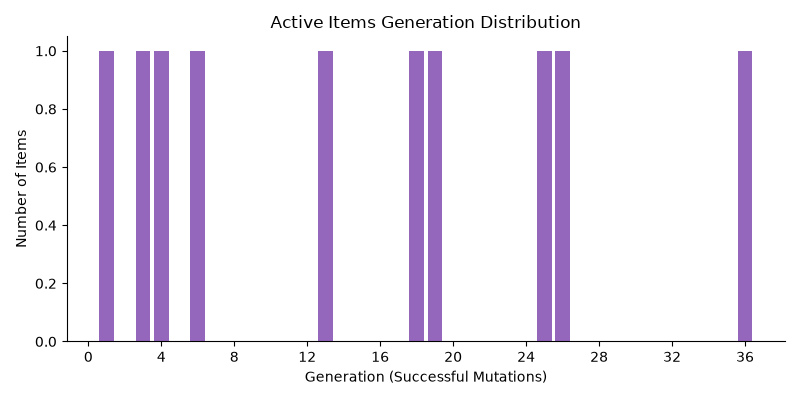
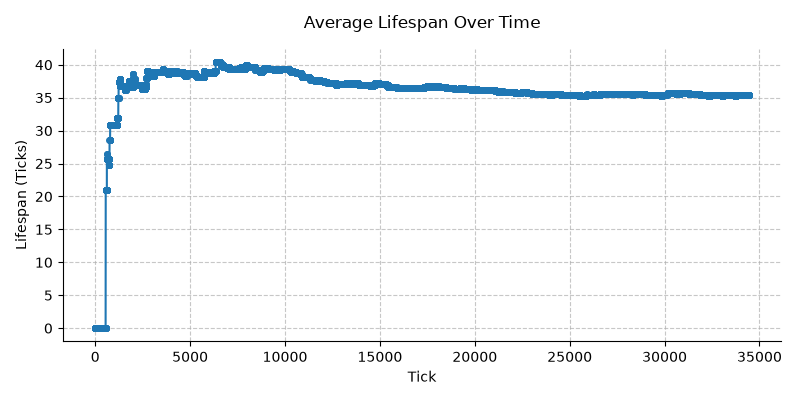
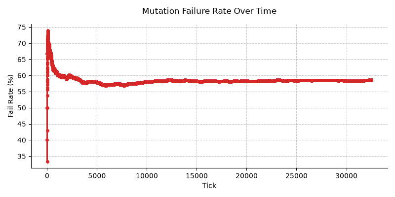
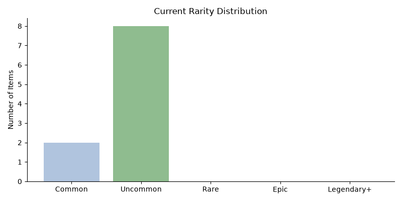
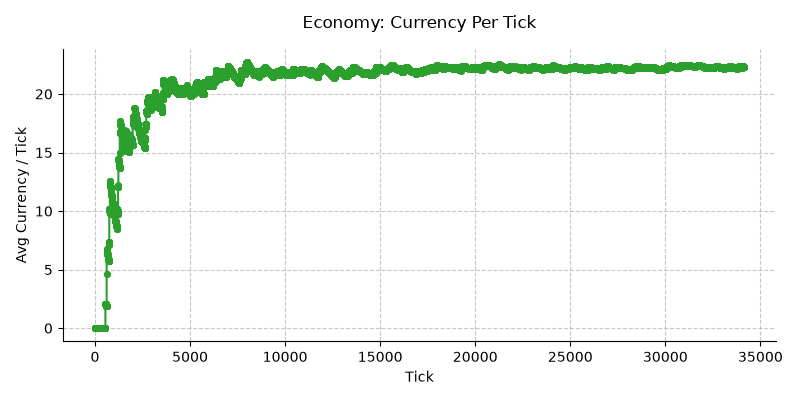

For the actual documentation, see [docs](docs/).

# World state overview

## Latest Tick
33657

## Oldest Item
Verdant Axe of Might

## Ecosystem Summary
- Active Items: 10
- Average Rarity: 2.0
- Average Volatility: 0.48
- Average Durability: 42.2

## Dominant Factions
- Order: 0.8
- STR: 0.7
- Stability: 0.4

## Extremes
- Most Stable Item: Verdant Axe of Might
- Most Volatile Item: Ancient Axe of Gales

## Recent Events
- MUTATED: 'Corrosive Rapier of Frost' evolved to generation 28.
- MUTATED: 'Brittle Shard of Mirage' evolved to generation 16.
- MUTATED: 'Mundane Bow of Iron' evolved to generation 18.

## Lifecycle Stats
- Items Created: 410
- Items Archived: 400
- Avg Lifespan (ticks): 35.4

### Distribution chart

### Average lifespan line chart

## Mutation Stats (Last Tick)
- Mutations Attempted: 33657
- Successful Mutations: 13953
- Failure Rate: 58.5%

## Rarity Distribution
- Common: 4
- Uncommon: 6
- Rare: 0
- Epic: 0
- Legendary+: 0

## Economy
- Total Currency: 747050
- Currency per Tick (avg): 22.2
- Recent Gains: 0

