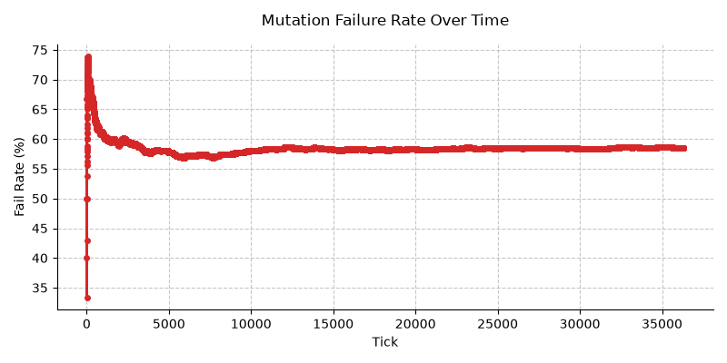

For the actual documentation, see [docs](docs/).

# World state overview

## Latest Tick
36257

## Oldest Item
Mundane Sigil of the Phoenix

## Ecosystem Summary
- Active Items: 10
- Average Rarity: 1.38
- Average Volatility: 0.45
- Average Durability: 56.79

## Dominant Factions
- Chaos: 0.5
- STR: 0.5
- DEX: 0.5

## Extremes
- Most Stable Item: Fractured Blade of Gales
- Most Volatile Item: Mundane Blade of Plagues

## Recent Events
- MUTATED: 'Nimble Rapier of Frost' evolved to generation 24.
- STABLE: 'Mundane Blade of Plagues' did not mutate this tick.
- STABLE: 'Silent Blade of Might' did not mutate this tick.

## Lifecycle Stats
- Items Created: 442
- Items Archived: 432
- Avg Lifespan (ticks): 35.5

### Distribution chart

### Average lifespan line chart

## Mutation Stats (Last Tick)
- Mutations Attempted: 36257
- Successful Mutations: 15051
- Failure Rate: 58.5%

## Rarity Distribution
- Common: 8
- Uncommon: 2
- Rare: 0
- Epic: 0
- Legendary+: 0

## Economy
- Total Currency: 808950
- Currency per Tick (avg): 22.31
- Recent Gains: 0

