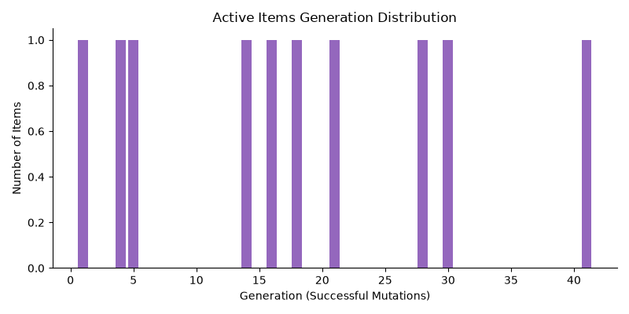
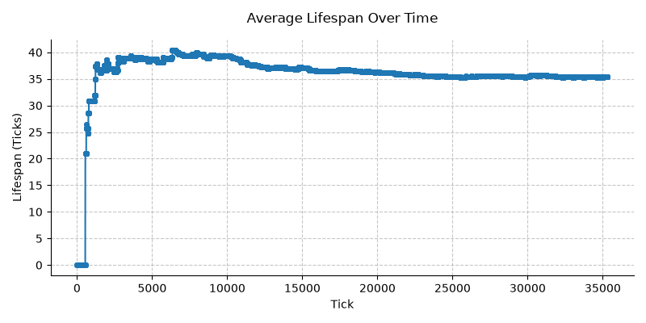
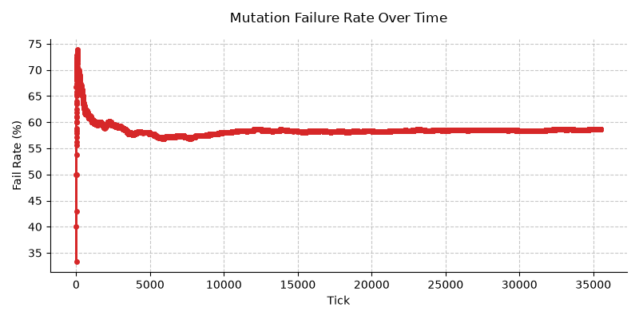
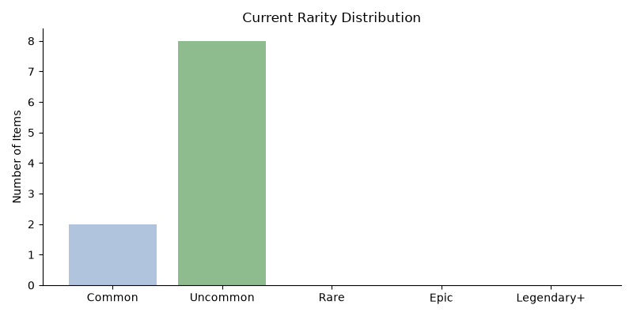
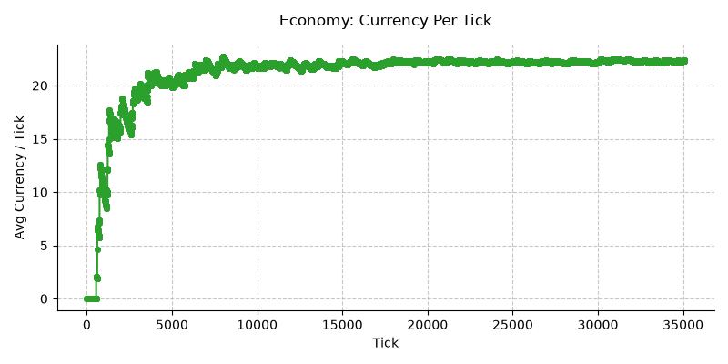

For the actual documentation, see [docs](docs/).

# World state overview

## Latest Tick
35807

## Oldest Item
Nimble Rapier of Frost

## Ecosystem Summary
- Active Items: 10
- Average Rarity: 1.6
- Average Volatility: 0.43
- Average Durability: 38.77

## Dominant Factions
- STR: 1.1
- Chaos: 0.9
- Order: 0.7

## Extremes
- Most Stable Item: Nimble Rapier of Frost
- Most Volatile Item: Singed Bow of Might

## Recent Events
- STABLE: 'Mundane Blade of Might' did not mutate this tick.
- MUTATED: 'Mundane Blade of Might' evolved to generation 27.
- STABLE: 'Silent Blade of Might' did not mutate this tick.

## Lifecycle Stats
- Items Created: 435
- Items Archived: 425
- Avg Lifespan (ticks): 35.4

### Distribution chart

### Average lifespan line chart

## Mutation Stats (Last Tick)
- Mutations Attempted: 35807
- Successful Mutations: 14854
- Failure Rate: 58.5%

## Rarity Distribution
- Common: 6
- Uncommon: 4
- Rare: 0
- Epic: 0
- Legendary+: 0

## Economy
- Total Currency: 794700
- Currency per Tick (avg): 22.19
- Recent Gains: 0

