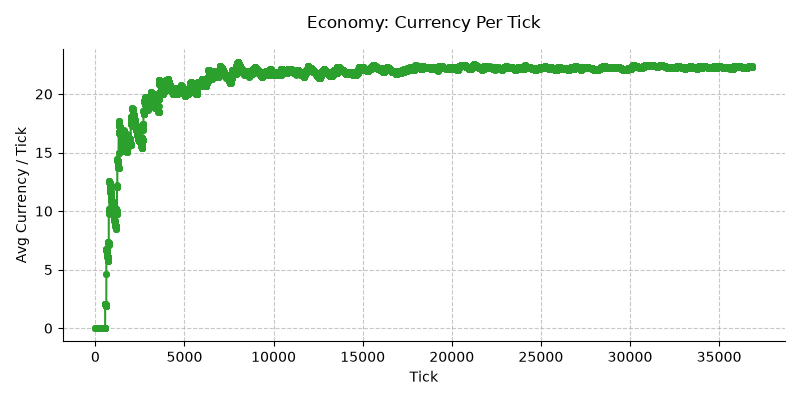

For the actual documentation, see [docs](docs/).

# World state overview

## Latest Tick
36582

## Oldest Item
Unstable Rapier of Carnage

## Ecosystem Summary
- Active Items: 10
- Average Rarity: 1.38
- Average Volatility: 0.48
- Average Durability: 48.15

## Dominant Factions
- Stability: 0.9
- DEX: 0.9
- Order: 0.7

## Extremes
- Most Stable Item: Phantom Spear of Ruins
- Most Volatile Item: Gilded Shard of Carnage

## Recent Events
- MUTATED: 'Mundane Spear of Iron' evolved to generation 9.
- MUTATED: 'Rusty Rapier of Frost' evolved to generation 23.
- STABLE: 'Unstable Rapier of Carnage' did not mutate this tick.

## Lifecycle Stats
- Items Created: 445
- Items Archived: 435
- Avg Lifespan (ticks): 35.4

### Distribution chart

### Average lifespan line chart

## Mutation Stats (Last Tick)
- Mutations Attempted: 36582
- Successful Mutations: 15208
- Failure Rate: 58.4%

## Rarity Distribution
- Common: 8
- Uncommon: 2
- Rare: 0
- Epic: 0
- Legendary+: 0

## Economy
- Total Currency: 814000
- Currency per Tick (avg): 22.25
- Recent Gains: 0

