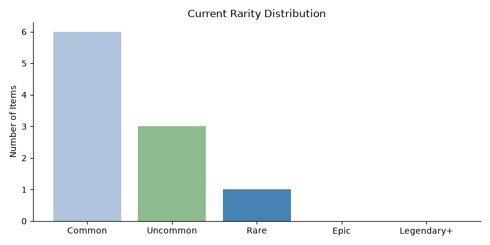

For the actual documentation, see [docs](docs/).

# World state overview

## Latest Tick
37132

## Oldest Item
Mundane Edge of Echoes

## Ecosystem Summary
- Active Items: 10
- Average Rarity: 2.19
- Average Volatility: 0.36
- Average Durability: 68.85

## Dominant Factions
- Stability: 0.6
- Order: 0.6
- Restoration: 0.4

## Extremes
- Most Stable Item: Mundane Edge of Echoes
- Most Volatile Item: Phantom Relic of Echoes

## Recent Events
- MUTATED: 'Glowing Sigil of Mirage' evolved to generation 8.
- MUTATED: 'Iridescent Shard of Frost' evolved to generation 3.
- STABLE: 'Mortal Blade of Judgement' did not mutate this tick.

## Lifecycle Stats
- Items Created: 454
- Items Archived: 444
- Avg Lifespan (ticks): 35.5

### Distribution chart

### Average lifespan line chart

## Mutation Stats (Last Tick)
- Mutations Attempted: 37132
- Successful Mutations: 15445
- Failure Rate: 58.4%

## Rarity Distribution
- Common: 6
- Uncommon: 3
- Rare: 1
- Epic: 0
- Legendary+: 0

## Economy
- Total Currency: 832900
- Currency per Tick (avg): 22.43
- Recent Gains: 0

